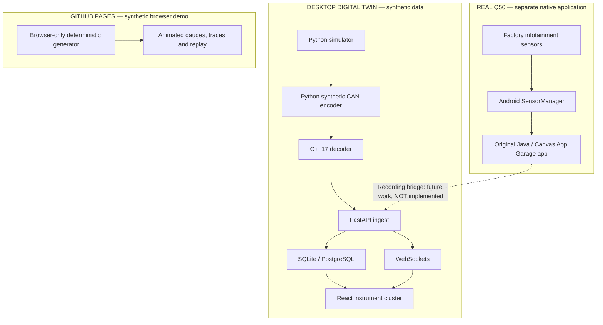

# Q50 Digital Twin

**From a simulated CAN bus to an Android telemetry app running on a 2017 Infiniti Q50 Red Sport 400.**

A computer-engineering project spanning **legacy Android, Java, Python, C++17, vehicle telemetry, FastAPI, PostgreSQL, WebSockets and React/TypeScript**. It includes an original instrument-cluster interface and a separate, read-only app for the factory Infiniti InTouch App Garage.

[**Launch the interactive browser demo**](https://aram-az.github.io/Q50-Digital-Twin/) · [**Explore the native in-car app**](native-app/README.md) · [**Architecture**](docs/architecture.md) · [**Build and test**](#build-and-test)

[](https://github.com/Aram-az/Q50-Digital-Twin/actions/workflows/phase2-ci.yml)

> **Real-car milestone (November 2026):** I built and installed my own `.epk` App Garage application on my 2017 Q50 Red Sport and confirmed that the app launches and operates on the factory touchscreen. Sensor mapping, accuracy, update rates and compatibility with other firmware versions still require independent validation. The in-car app is **not yet connected to the desktop dashboard**.

## Try it in 60 seconds

Open the **[live instrument-cluster showcase](https://aram-az.github.io/Q50-Digital-Twin/)**. No account, download, backend or vehicle connection is required.

1. Watch the dual animated RPM/speed gauges and multi-function display.
2. Select **Overheating** → **Start Simulation**; inspect the thermal alert on MFD preset **02**.
3. Select **Sensor Dropout** → **Start Simulation**; inspect the timestamp gap and diagnostic log on preset **04**.
4. Replay a generated session using the transport controls; switch between **DRIVE / THERMAL / TRACE / LOGBOOK**.

**Public-site data is entirely synthetic and generated in your browser.** This is a demonstration of the UI, simulation and diagnostic rules—not a connection to my car or a public automotive API. The **local development build** additionally supports persistent FastAPI sessions and WebSockets. [How the showcase works →](docs/showcase.md)

## The engineering work

| Subsystem | Implementation | What it demonstrates |
|---|---|---|
| **Native infotainment application** | Java, Android API 10, Canvas, SensorManager | Read-only vehicle sensor integration, lifecycle handling, stale-value detection, native gauge rendering |
| **App Garage package toolchain** | PowerShell, Python, signed APK, EPK v2 | Legacy Android build pipeline and documented binary-format packaging |
| **Synthetic vehicle and CAN pipeline** | Python encoder + C++17 decoder | Deterministic telemetry, byte encoding/decoding, validation, sequence checking, cross-language testing |
| **Telemetry backend** | FastAPI, SQLAlchemy, WebSockets | Ingestion, validation, session persistence, live events, transaction handling |
| **Database** | SQLite / PostgreSQL | Session history, queries, aggregated metrics |
| **Instrument-cluster interface** | React, TypeScript, SVG, CSS | Animated tachometer/speedometer, gauges, replay, plotting, simulated diagnostics |
| **Verification** | Python unittest, Java tests, Node tests, GitHub Actions | Automated coverage across the software stack |

### Architecture: two distinct, honest data paths



**Important:** CAN message identifiers `0x500` and `0x501` belong to the project's **synthetic test protocol**. They are *not* the vehicle's actual Infiniti CAN IDs. The native app instead uses reported head-unit sensor interfaces; it does not send CAN commands, flash ECU firmware or control vehicle functions.

## Real vehicle integration: Phase 6

My native application targets the original App Garage-capable InTouch hardware using the legacy Android interface. It features a custom **800 × 480 Canvas display**, read-only vendor sensor subscriptions, a raw-sensor audit screen, transient peak tracking and explicit `--` indicators when signals are unavailable or stale.

The app is packaged by a reproducible build script into an APK and then an EPK container. The build uses a public compatibility certificate; **private signing keys are not committed**.

- **[Native app source](native-app/src/com/aram/q50telemetry/)** — `Q50Activity`, `TelemetryView`, `SensorState`
- **[Build and packaging](native-app/build.ps1)** — Windows PowerShell toolchain
- **[EPK packager](native-app/tools/build_epk.py)** — Python implementation and tests
- **[Native installation documentation](native-app/docs/INSTALL_WINDOWS.md)** — requirements, parked-only compatibility checks and limitations
- **[Vehicle verification log template](native-app/docs/VERIFICATION_LOG.md)** — record real signal validation, pending further measurements

**Status:** App installation and operation on my own 2017 vehicle: confirmed by owner. **Verified signal calibration and real-car recording/export: pending.** No telemetry from this vehicle is hosted publicly.

## Desktop instrument lab

The original dashboard was redesigned as a distinct, GT-R-MFD-inspired instrument rather than a generic admin interface. All styling and rendering code in this project is original.

- **Dual animated dials** with needle travel, shift indicators and throttle demand.
- Four switchable MFD screens: **DRIVE**, **THERMAL**, **TRACE**, **LOGBOOK**.
- Simulation scenarios (idle, cruise, acceleration, mixed, overheating, sensor dropout).
- Session history, time-aware replay and illustrative **non-OEM** diagnostic thresholds.
- Standalone **GitHub Pages showcase** (in-browser simulation) and a fuller **local API-connected mode**.

<!-- Real media goes here after a verified parked-car recording. Do not substitute generated 'in-car' evidence. -->
**Demo footage and photos:** coming after a parked-car recording. [Media checklist and safe capture guide](docs/media/README.md).

## Build and test

<details>
<summary><strong>Run the full desktop stack (Windows 11 / PowerShell)</strong></summary>

Requires Python 3.11+, Node.js 22+, C++17 compiler (for the CAN pipeline) and optionally PostgreSQL/Docker.

```powershell
# In repository root
python -m venv .venv
.\.venv\Scripts\python.exe -m pip install -r backend\requirements.txt
if (!(Test-Path .env)) { Copy-Item .env.example .env }
# Use Q50_DATABASE_URL=sqlite+pysqlite:///./data/q50-local.db for the easiest local start
.\.venv\Scripts\python.exe -m uvicorn backend.app.main:app --host 127.0.0.1 --port 8000 --reload
```

In another terminal:

```powershell
cd frontend
npm ci
npm run dev
```

Open `http://127.0.0.1:5173/` for the instrument cluster and `http://127.0.0.1:8000/docs` for interactive API docs.

</details>

<details>
<summary><strong>Native Android / EPK build (Windows)</strong></summary>

Use JDK **17** and Android SDK platform/build-tools **34**. See [native-app/README.md](native-app/README.md) for setup, signing-key handling and parked-only compatibility testing. Build generated files and secrets are ignored by Git.

```powershell
.\.venv\Scripts\python.exe -m pip install -r native-app\requirements-build.txt
.\native-app\build.ps1
```

</details>

<details>
<summary><strong>Run tests and build the public showcase</strong></summary>

```powershell
.\.venv\Scripts\python.exe -m unittest discover -s tests -v
.\.venv\Scripts\python.exe -m unittest discover -s native-app\tests -p "test_*.py" -v
# For Java tests, see native-app/README.md
cd frontend
npm ci
npm run test:logic
npm run build
npm run build:showcase
```

For the cross-language round trip, compile `decoder/src/main.cpp` (C++17), run `canbus.cli` on simulator JSONL, decode the synthetic CAN log and run `tools/verify_roundtrip.py`. [Full instructions](docs/phase2.md).

</details>

## Documentation and project tour

| Start here | What you'll find |
|---|---|
| [Architecture and design decisions](docs/architecture.md) | System boundaries, validation strategy and future integration plan |
| [Browser showcase and deployment](docs/showcase.md) | How the public simulation works; GitHub Pages publishing instructions |
| [Native Android app](native-app/README.md) | In-car integration, sensor reading, app package build and limitations |
| [Simulator / CAN](docs/phase1.md) · [protocol](schemas/synthetic-can-protocol.md) · [C++ decoder](decoder/src/main.cpp) | Test data generation and low-level processing |
| [Backend](docs/phase3.md) · [FastAPI implementation](backend/app/main.py) | Sessions, WebSocket streaming and persistence |
| [Instrument UI](docs/phase5.md) · [React implementation](frontend/src/App.tsx) | Design, responsive gauges and custom SVG |
| [Automated CI](.github/workflows/phase2-ci.yml) · [Pages deployment](.github/workflows/deploy-pages.yml) | Continuous tests and static demo deployment |

## What comes next

1. **Sensor verification** — cross-check actual RPM, coolant, temperatures and throttle readings with trusted instrumentation while stationary; document rates and firmware compatibility.
2. **Real telemetry recording** — develop a safe, user-initiated, read-only export process *if* the head unit permits it, and import validated records into the existing FastAPI schema.
3. **Performance analysis** — record sensor latency, dropped samples, rendering FPS and memory usage on the target hardware.
4. **Evidence** — post a short, stationary in-car walkthrough, paired with a screenshot of the browser simulation.

## Safety and attribution

This is an independent educational project, unaffiliated with Infiniti or Nissan. **No ECU write access, diagnostic actuation, tuning or flashing** is implemented. The demonstration thresholds are illustrative, not certified vehicle limits. Do not interact with the display while driving.

App Garage packaging and sensor-interface research builds on public, MIT-licensed community work by [AppGarage Dash](https://github.com/bugjosh/appgarage-dash) and [Q50 App / O.R.I.O.N.](https://github.com/czpeanut/q50-app). The native Java UI and application source in this repository are separate implementations.
